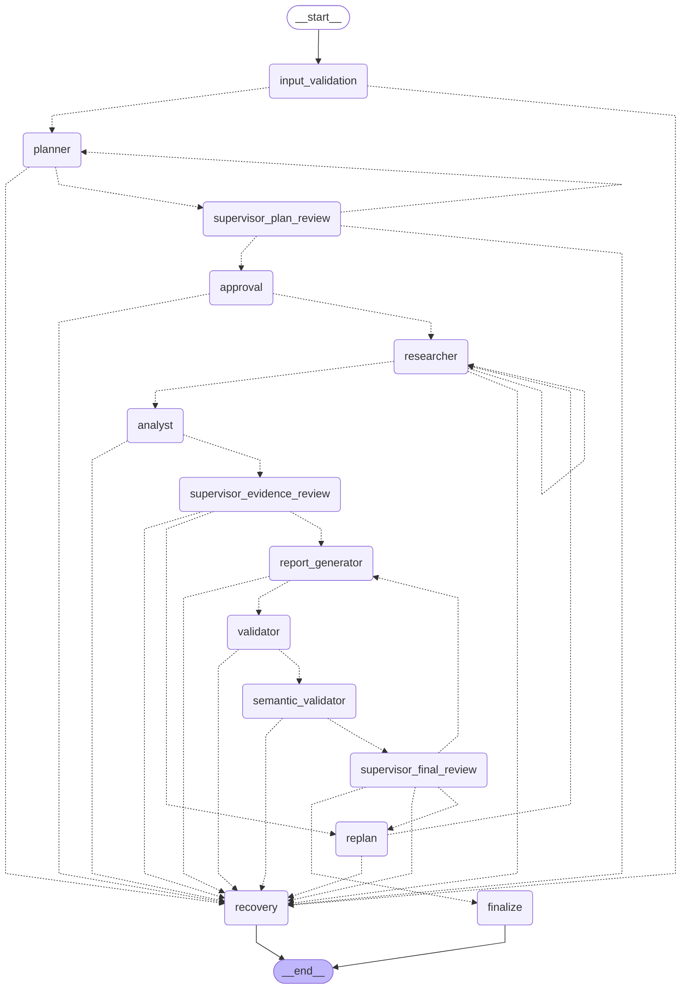
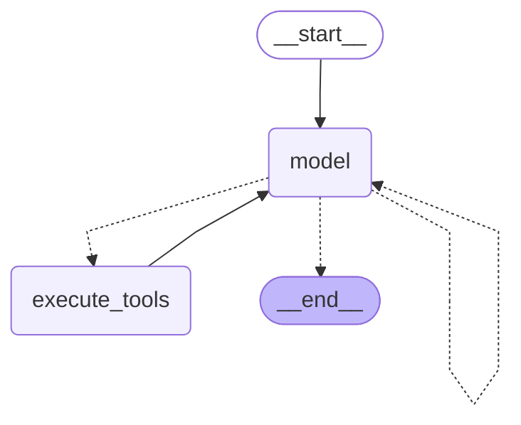

# Compiled workflow diagrams

Generated with `python -m scripts.export_graph`; both diagrams come from `get_graph().draw_mermaid()`. The model adapter is used only to compile structure. This export performs no inference and is not execution evidence.

## Coordinator

## Researcher tool loop

